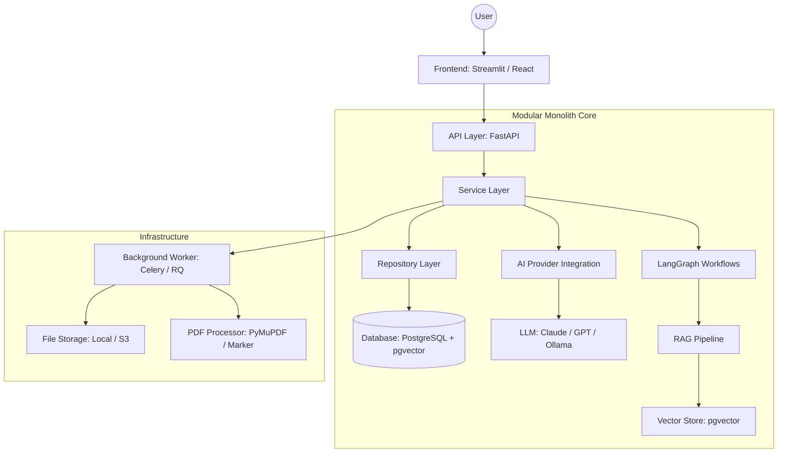

# System Architecture - StudyPilot

StudyPilot is designed as a **Modular Monolith**. This approach provides the simplicity of a single deployment unit while maintaining the strict separation of concerns required for a scalable AI application.

## 1. High-Level Architectural Diagram

## 2. Layer Responsibilities

### Frontend
- User Interface for document upload, chat, quiz taking, and analytics.
- Session management and authentication tokens.

### API Layer (FastAPI)
- REST endpoints for frontend communication.
- Request validation using Pydantic schemas.
- Middleware for authentication and error handling.

### Service Layer (Business Logic)
- Orchestrates the flow between API and Repositories.
- Contains business rules (e.g., SRS algorithm, study plan logic).
- Invokes LangGraph workflows for complex AI tasks.

### Repository Layer (Data Access)
- Pure data access logic.
- Abstracts the database implementation (SQLAlchemy).
- Handles CRUD operations for users, documents, and flashcards.

### AI Provider Integration
- Abstract interface to wrap different LLM providers.
- Handles prompt templating and token counting.

### LangGraph Workflows
- State-managed agentic flows for:
    - Document Ingestion $\rightarrow$ Chunking $\rightarrow$ Indexing.
    - Quiz Generation $\rightarrow$ Validation $\rightarrow$ Formatting.
    - RAG: Query $\rightarrow$ Retrieval $\rightarrow$ Synthesis $\rightarrow$ Citation.

## 3. Technical Stack (OSS Focused)

| Component | Technology | Reason |
| :--- | :--- | :--- |
| **Backend Framework** | FastAPI | High performance, async support, native Pydantic. |
| **Language** | Python 3.11+ | Industry standard for AI/ML. |
| **Database** | PostgreSQL + pgvector | Unified relational and vector storage. |
| **ORM** | SQLAlchemy | Mature, flexible database abstraction. |
| **AI Orchestration** | LangGraph / LangChain | Sophisticated state management for agents. |
| **LLM Providers** | Anthropic / OpenAI / Ollama | Flexibility to switch between cloud and local. |
| **Background Tasks** | Celery + Redis | Asynchronous processing of PDF indexing. |
| **File Storage** | Local Disk / MinIO | Simple, OSS-compatible object storage. |
| **Frontend** | Streamlit (MVP) $\rightarrow$ React | Fast prototyping transitioning to a full app. |

## 4. Data Flow: Document Ingestion
1. **Upload**: User uploads PDF $\rightarrow$ API $\rightarrow$ File Storage.
2. **Queue**: API triggers Background Worker.
3. **Process**: Worker extracts text $\rightarrow$ Chunks text $\rightarrow$ Generates Embeddings.
4. **Index**: Embeddings saved to `pgvector` with `user_id` metadata.
5. **Notify**: User notified that document is ready for querying.

## 5. Data Flow: RAG Query
1. **Query**: User asks question $\rightarrow$ API $\rightarrow$ LangGraph Workflow.
2. **Retrieve**: Workflow embeds query $\rightarrow$ Vector search in `pgvector` (filtered by `user_id`).
3. **Synthesize**: LLM generates answer using retrieved chunks as context.
4. **Verify**: Workflow checks for hallucinations/citations $\rightarrow$ Returns answer.
