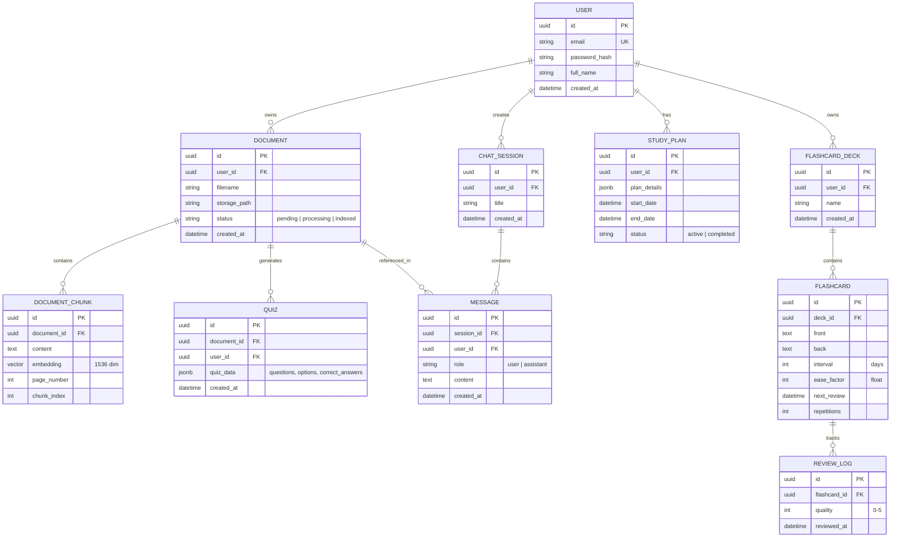

# Database Design - StudyPilot

The database uses PostgreSQL with the `pgvector` extension to store both structured relational data and unstructured vector embeddings in a single system.

## 1. ER Diagram

## 2. Table Descriptions

### Users & Auth
- `USER`: Stores basic account information. `email` is unique for authentication.

### Knowledge Base (RAG)
- `DOCUMENT`: Metadata for uploaded PDFs.
- `DOCUMENT_CHUNK`: The core of the RAG system. Stores text segments and their corresponding embeddings. The `embedding` column uses `pgvector`.

### AI Interactions
- `CHAT_SESSION`: Groups messages into conversations.
- `MESSAGE`: Stores the history of user and AI interactions.

### Learning Tools
- `QUIZ`: Stores AI-generated quizzes as JSONB for flexibility in question types.
- `FLASHCARD`: Stores flashcards using the SM-2 spaced repetition model (interval, ease\_factor, repetitions).
- `REVIEW_LOG`: History of flashcard reviews to analyze learning curves.
- `STUDY_PLAN`: AI-generated schedules stored as JSONB.

## 3. Indexing Strategy
- **B-Tree Indexes**: On all Foreign Keys (`user_id`, `document_id`, `session_id`) for fast relational joins.
- **HNSW Index**: On `DOCUMENT_CHUNK.embedding` for fast approximate nearest neighbor (ANN) search.
- **GIN Index**: On `QUIZ.quiz_data` if complex JSON searches are needed.

## 4. Data Isolation
All queries to `DOCUMENT`, `DOCUMENT_CHUNK`, `MESSAGE`, `FLASHCARD`, and `STUDY_PLAN` must include a `WHERE user_id = :current_user_id` clause to ensure strict data isolation.
