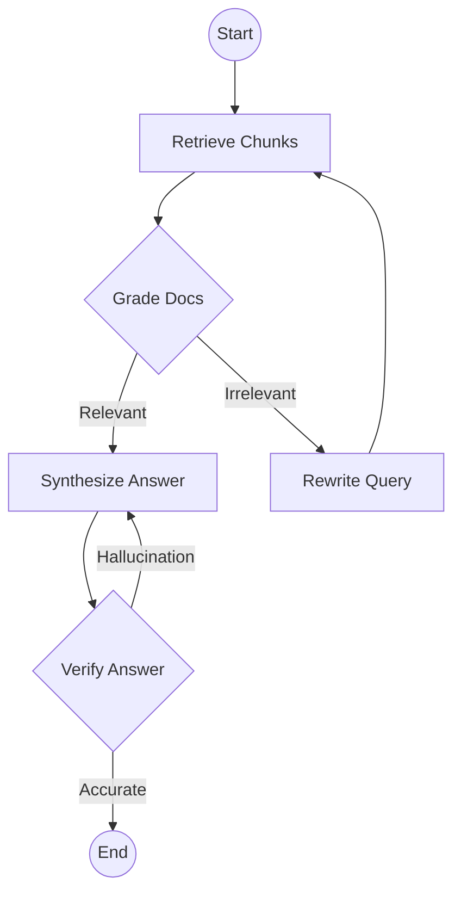
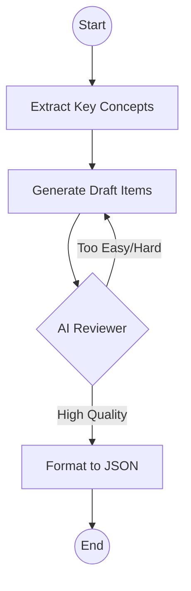

# LangGraph Design - StudyPilot

StudyPilot uses LangGraph to manage complex, stateful AI workflows. Unlike simple chains, LangGraph allows for cycles, conditional logic, and explicit state management, which is critical for reliable RAG and content generation.

## 1. State Definition
The `AgentState` is shared across the graph and tracks the progress of the workflow.

```python
class AgentState(TypedDict):
    user_id: str
    query: str
    context_docs: List[DocumentChunk]
    answer: str
    iterations: int
    status: str  # "retrieving", "synthesizing", "verifying", "completed"
    citations: List[str]
    error: Optional[str]
```

## 2. Workflow: RAG Query Pipeline
The RAG pipeline is designed to minimize hallucinations by implementing a "Retrieve $\rightarrow$ Grade $\rightarrow$ Synthesize $\rightarrow$ Verify" loop.



### Node Responsibilities:
- **Retrieve**: Performs vector search in `pgvector` filtered by `user_id`.
- **Grade**: A "Grader" LLM checks if the retrieved chunks actually answer the query.
- **Rewrite**: If docs are irrelevant, an LLM optimizes the query for a second retrieval attempt.
- **Synthesize**: Generates the final response using the context and providing citations.
- **Verify**: Checks if the answer is grounded in the context (Anti-hallucination check).

## 3. Workflow: Quiz & Flashcard Generation
This workflow ensures that generated learning materials are pedagogically sound.



### Node Responsibilities:
- **Extract**: Analyzes document chunks to find primary concepts, definitions, and relationships.
- **Gen**: Creates multiple-choice questions or flashcards based on concepts.
- **Review**: A separate "Reviewer" LLM evaluates the items for clarity, correctness, and difficulty.
- **Format**: Ensures the output matches the database schema exactly.

## 4. Integration with API
LangGraph workflows are invoked as asynchronous tasks within the Service Layer.
- API call $\rightarrow$ Service $\rightarrow$ `graph.ainvoke(initial_state)` $\rightarrow$ Result $\rightarrow$ API Response.
